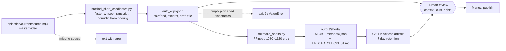

# facelessIG

Multimodal content pipeline: **audio in → transcript → edited video clips → publish**.

Built as a personal automation experiment for faceless social content. Maps to the same pattern used in business workflows: ingest media, call AI services, transform, and output a finished asset.

## Pipeline

1. Source video or audio
2. Speech-to-text / transcript
3. Turn transcript into a video
4. Cut into clips
5. Review and post (manual today)

## Why it exists

Practice wiring **voice, text, and video** tools into one sequence instead of using each model by hand.

## Status

Personal experiment / portfolio piece. Treat this as a workflow sketch + implementation sandbox, not a production SaaS.

## Stack intent

- Media ingest
- Transcription
- LLM or template logic for structure
- Clip/edit step
- Publish step

## Architecture

What is implemented today (see [`docs/production-pipeline.md`](docs/production-pipeline.md)):



- **Transcription:** faster-whisper (`tiny`/`base`/`small`, CPU int8, VAD filter).
- **Candidate selection:** windows of 20–58 s scored on hook words, questions, contrast words ("but", "however"), and target length; overlapping picks are removed. This is a heuristic, not an LLM.
- **Rendering:** FFmpeg center-crop to 9:16, H.264/AAC, one file per clip, plus a metadata manifest with `upload_status: not_uploaded`.

## System design notes

- **Two small CLIs instead of one script.** Candidate finding and rendering are separate, so a person can edit the clip plan JSON between steps or hand-write one (`episodes/current/clips.json`).
- **Heuristic before LLM.** Scoring is cheap, deterministic and runs on a CPU runner. An LLM ranking step is a possible upgrade but isn't built.
- **Human in the loop by design.** Titles are drafts, every run writes an upload checklist, and nothing is published automatically. Rights and context are checked by a person.
- **Tradeoffs:** center-crop can cut off subjects (no smart reframing); no captions yet; Whisper on CPU is slow for long episodes.

## Deploy & ops

**Local**

```bash
sudo apt-get install -y ffmpeg        # or brew install ffmpeg
pip install -r requirements.txt
python3 src/find_short_candidates.py --source episodes/current/source.mp4 --model base --count 6
python3 src/make_shorts.py --source episodes/current/source.mp4 --plan episodes/current/auto_clips.json
```

**CI** (`.github/workflows/render-shorts.yml`, manual `workflow_dispatch` only): installs FFmpeg + deps → finds candidates → renders clips → uploads `output/shorts/` as the `becoming-giant-shorts` artifact (fails if no files). 60-minute timeout; a concurrency group prevents overlapping renders.

**Secrets / env:** none required today. Do not commit private footage, signed media URLs, or platform passwords/cookies; this repo is public.

**Known limits:** the source video must be in the repo path (no media storage connected yet); no captions, reframing, narration, or upload adapter; candidate quality needs human review.

## Related

- Prompt work: [prompt-engineering-portfolio](https://github.com/becominggiant/prompt-engineering-portfolio)
- Agents: [agentfi-executor](https://github.com/becominggiant/agentfi-executor)
